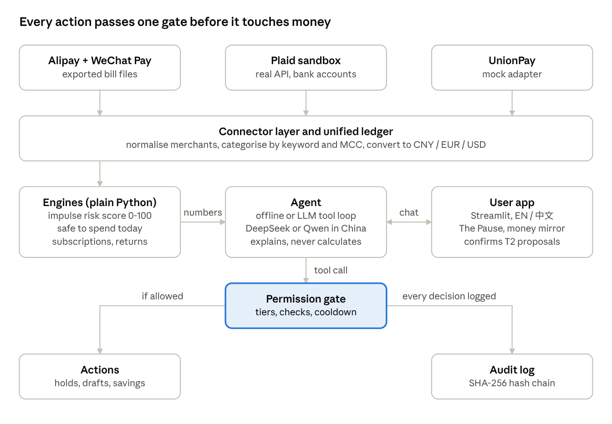
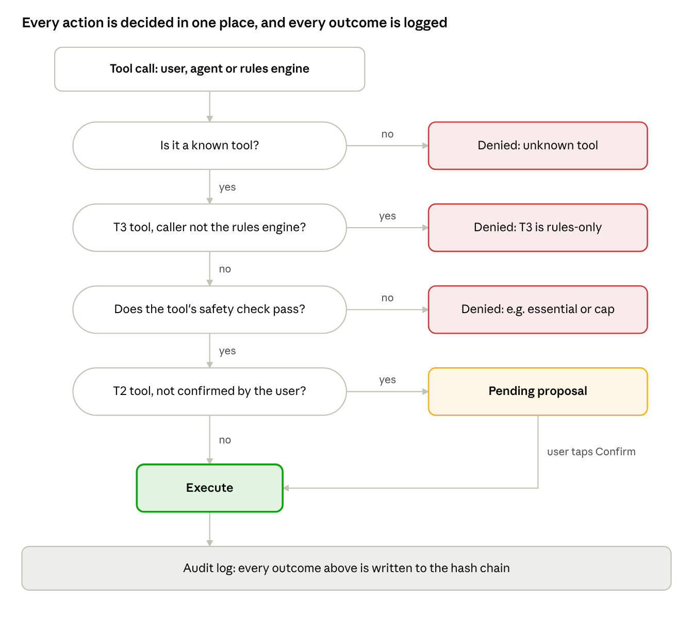

# Second Thought (再想想) – Technical Documentation

Oct 20, 2026

Second Thought is a personal finance assistant (FinTechathon 2026, International Track, Topic A) for people with impulsive or compulsive spending patterns. This document describes its architecture, core algorithms and security design as implemented in the submitted repository.

## 1. Overview and scope

Second Thought reads a person's payment data, tells them what is safe to spend, finds avoidable costs, and puts a pause between an impulsive urge and the payment. It acts only inside limits the user set while calm, and it can never move money to anyone else.

| Topic A requirement        | Implementation                                                                                                                           | Module                                                          |
|----------------------------|------------------------------------------------------------------------------------------------------------------------------------------|-----------------------------------------------------------------|
| Smart budgeting            | Safe to spend today, with a full breakdown                                                                                               | engine/safe_to_spend.py                                         |
| Bill analysis              | Subscriptions, overlapping services, converted free trials, price rises, fees, open instalments ("ADHD tax" report), cancellation drafts | engine/subscriptions.py, services.py                            |
| Spending insights          | Weekly money mirror: impulse, night and live-stream share, spending on days with logged stress, one suggestion                           | engine/insights.py                                              |
| Actionable recommendations | The Pause (impulse risk score), parking lot, save-the-urge transfers, return requests                                                    | engine/risk_score.py, engine/returns.py, policy/rules_engine.py |

Target users are described by spending patterns, never by diagnosis: late-night impulse buying (typical for ADHD), spending sprees (for example in bipolar disorder), mood-driven shopping, and live-stream or buy-now-pay-later buying. The app stores no health data.

What is real in this submission:

- **Real:** parsers for user-exported Alipay and WeChat Pay bills, Plaid Sandbox API client, all engines, the permission gate, audit log, offline agent, LLM tool loop, Streamlit app (EN / 中文), the Checkout Pause browser extension with its local API, 51 automated tests.

- **Sandbox:** money movements (transfers to the user's own savings pot) and holds are simulated in the app; Plaid runs against its sandbox.

- **Mock:** UnionPay card statement adapter.

- **Demo data:** a synthetic persona (Mei, 26, Shenzhen) generated by scripts/generate_demo_data.py. No real personal data is used. Merchant and platform names appear only the way they would in a person's own bill export and say nothing about those companies; the demo shop for the extension is fictional.

## 2. System architecture

The system is a Python package with five layers. Data flows downwards from connectors to a unified ledger and the engines; every action, whether it comes from the user interface, the agent or the rules engine, passes one permission gate and is written to a hash-chained audit log. The guiding rule is **the model talks, the code calculates**: every figure comes from deterministic code, and the language model only explains results and selects tools.

system architecture · connectors to audit log

Data moves down from the payment sources; the agent only reaches money through the permission gate, and every decision is logged.

| Layer         | Modules                                                                                                     | Responsibility                                                                                                 |
|---------------|-------------------------------------------------------------------------------------------------------------|----------------------------------------------------------------------------------------------------------------|
| Connectors    | connectors/alipay_csv.py, wechat_bill.py, plaid_sandbox.py, unionpay_mock.py                                | Turn each source into Transaction objects                                                                      |
| Engines       | engine/ledger.py, categories.py, risk_score.py, safe_to_spend.py, subscriptions.py, returns.py, insights.py | Merge, normalise, convert currencies, compute every number                                                     |
| Services      | services.py                                                                                                 | Business actions over the application state (park, save, draft, change rules)                                  |
| Policy        | policy/gate.py, plan.py, rules_engine.py, audit_log.py                                                      | Permission tiers, calm-state plan with cooldown, the only caller of automatic (T3) actions, tamper-evident log |
| Agent         | agent/tools.py, router.py, llm.py, safety.py, prompts.py                                                    | Gated toolbox, offline agent, OpenAI-compatible LLM loop, crisis detection, redaction                          |
| App and state | app/streamlit_app.py, state.py, demo.py                                                                     | Bilingual user interface, persisted state per data region, demo loader                                         |

Technology: Python 3.11+, Streamlit, pandas, openpyxl, requests, cryptography (Fernet), pytest. State is stored as JSON per region, optionally encrypted. Any OpenAI-compatible chat endpoint can serve as the model; presets exist for DeepSeek and Qwen (DashScope).

## 3. Data model and connectors

Every source is turned into the same Transaction record (models.py), so the engines never need to know where a payment came from.

| Field                           | Meaning                                                                                              |
|---------------------------------|------------------------------------------------------------------------------------------------------|
| id                              | Source prefix plus the provider's order number (ali-…, wx-…, plaid-…, up-…); used for de-duplication |
| timestamp                       | Local time of the user                                                                               |
| amount, currency                | Always positive, original currency                                                                   |
| direction                       | expense, income or neutral (transfers, credit repayments, moving money to Yu'e Bao)                  |
| merchant, description           | Counterparty and item text from the provider                                                         |
| category                        | Normalised category (food, clothing, beauty, subscriptions, housing, …)                              |
| tags                            | livestream, flash_sale, online, fee                                                                  |
| is_instalment, instalment_count | Paid with Huabei, JD Baitiao, Klarna and similar, with the number of instalments when given          |
| mcc                             | Merchant category code for card and bank feeds                                                       |
| amount_base                     | Converted into the user's base currency                                                              |

### Connectors

| Connector           | Input                                                                           | Notes                                                                                                                                                                 | Status                                                        |
|---------------------|---------------------------------------------------------------------------------|-----------------------------------------------------------------------------------------------------------------------------------------------------------------------|---------------------------------------------------------------|
| Alipay 支付宝       | Bill export CSV that the user downloads in the app                              | GB18030/GBK decoding, an info block of 15-25 lines above the table is skipped by searching for the header row, trailing tab characters removed, closed orders skipped | Real parser                                                   |
| WeChat Pay 微信支付 | Bill export as CSV or XLSX                                                      | Detects XLSX by its zip signature, strips the ¥ sign, treats "/" in the income/expense column as neutral                                                              | Real parser                                                   |
| Plaid Sandbox       | /sandbox/public_token/create → /item/public_token/exchange → /transactions/sync | Polls until sandbox data is ready; Plaid's sign convention (positive = money out) mapped; every request logged with endpoint, status and request id, never secrets    | Real sandbox API (needs free keys); offline fixture otherwise |
| UnionPay 银联       | JSON card statement                                                             | Same interface a bank partner would implement; uses MCC codes                                                                                                         | Mock                                                          |

To our knowledge, Alipay's and WeChat Pay's open platforms serve merchants that receive payments; there is no public API that lets a third-party app read a consumer's own history. The user-triggered bill export is therefore the route that works today, and it keeps the user in control of what is shared.

### Normalisation

- **Categories** (engine/categories.py): explicit keyword rules in Chinese and English first (for example 滞纳金 or "overdraft" → fees, 花呗还款 → credit repayment), then the provider's own category (Alipay 交易分类, Plaid personal finance category), then the merchant category code.

- **Essentials** (groceries, health, transport, utilities, housing, education, repayments, fees) are marked; they are never held by the system.

- **Channel tags**: 直播, 抖音商城, 淘宝直播 and similar mark live-stream purchases; 秒杀 and 限时 mark flash sales.

- **Currencies** are converted with fixed demo reference rates (engine/ledger.py); production would use the daily PBoC and ECB reference rates.

## 4. Core algorithms

All algorithms are deterministic, explainable and covered by tests. Each produces the reasons it used, so the interface can show them.

### 4.1 Impulse risk score (engine/risk_score.py)

The score is the capped sum of the points of every signal that applies to a purchase (or a purchase intent in The Pause):

R = min(100, Σ pᵢ · sᵢ) for the 8 signals i, with sᵢ = 1 if signal i applies, else 0

| Signal                   | Rule                                                                                                                                            | Points |
|--------------------------|-------------------------------------------------------------------------------------------------------------------------------------------------|--------|
| Night                    | Local time between 23:00 and 05:00                                                                                                              | 20     |
| Burst                    | 2 or more other purchases in the 60 minutes before                                                                                              | 20     |
| Live stream / flash sale | Tag livestream or flash_sale                                                                                                                    | 15     |
| Amount spike             | Amount above mean + 2 standard deviations of the user's purchases in that category over 90 days (all purchases if fewer than 5 in the category) | 15     |
| Trigger category         | Category on the user's self-chosen trigger list                                                                                                 | 15     |
| Instalments              | Paid with Huabei, Baitiao, Klarna or similar                                                                                                    | 10     |
| Festival or payday       | Double 11 (10-11 Nov), 618 (16-18 Jun), Double 12, Black Friday to Cyber Monday, or 0-2 days after payday                                       | 10     |
| Mood                     | User logged mood ≤ 2 or stress ≥ 4 (scale 1-5) in the last 3 hours                                                                              | 10     |

Bands: below 40 green (log only), 40 to 69 amber (nudge), 70 and above red (The Pause offers park, skip or buy; calm-state rules may hold the purchase). Example: Mei's ¥899 jacket at 23:50 scores 20 + 20 + 15 + 15 = 70.

### 4.2 Safe to spend today (engine/safe_to_spend.py)

S = (B + I − F − G − R) / d

B is the sum of current balances converted to the base currency; I is other income expected before the next payday; F sums fixed bills, credit and BNPL repayments and detected subscriptions due between today and the next payday; G is the monthly savings contribution times d/30; R is a buffer, by default 10% of monthly fixed costs including subscriptions; d is the number of days until the next payday (at least 1). For the demo persona: (11,827.60 − 6,441.24 − 1,050 − 492.42) / 21 = ¥183.04.

Cost of a purchase in working time: hours = amount / (monthly income / monthly working hours).

### 4.3 Subscription detection and bill check (engine/subscriptions.py)

1.  Group non-essential expenses by a normalised merchant key (known service names such as 爱奇艺, Spotify or 百度网盘 map to one key).

2.  A group is a subscription if it has 2 or more paid charges whose gaps all fall in one cadence window: weekly 6-8 days, monthly 28-32 days, yearly 360-370 days.

3.  Amounts must lie within 10% of each other; exactly one upward price step is allowed and flagged as a price rise when the last charge exceeds the first by more than 5%.

4.  A zero-amount charge 5-9 or 28-32 days before the first paid charge flags a free trial that turned into a paid plan.

5.  Subscriptions charged on a foreign-currency bank feed are flagged as "old foreign account".

6.  Two or more active services in the same group (video, music, cloud, audio, design) are flagged as overlapping; all but the cheapest become cancellation candidates.

The bill check adds fees (late fees, overdue interest, overdraft) and open instalments. Avoidable costs over 90 days = fees in the window + monthly cost of cancellation candidates × 3. For the demo persona: 8 subscriptions, 3 probably forgotten, 2 fees, about ¥563.

### 4.4 Return windows (engine/returns.py)

Online purchases in returnable categories (clothing, beauty, electronics, household, sports) get a deadline of purchase date + 7 days in China (Consumer Rights Protection Law, Art. 25, seven-day no-reason return; custom, perishable, digital and print goods are excluded) or + 14 days in the EU (right of withdrawal). The law counts from receipt; we count from purchase, so the deadline shown is never later than the real one. Impulse-flagged purchases (risk ≥ 40) are listed first, then by days left.

### 4.5 Money mirror (engine/insights.py)

Over 7 or 30 days: non-essential spending, the shares of impulse-flagged, night-time and live-stream spending, spending by hour and category, and average daily spending on days with logged stress versus other days. One suggestion is chosen by fixed rules: lower the night-hold threshold if most night purchases fall under it, switch the night hold on if it is off, park live-stream buys if they exceed 25%, or cancel overlapping services.

## 5. Agent design

The assistant (agent/\_\_init\_\_.py) runs every message through a safety check first, then through one of two agents that share the same gated toolbox: an LLM agent when a model is configured and the user consented, otherwise an offline agent. Both can do exactly the same things, because both can only call tools.

### 5.1 Tool catalogue

| Tier               | Tools available to the agent                                                                                                | Effect                                                                   |
|--------------------|-----------------------------------------------------------------------------------------------------------------------------|--------------------------------------------------------------------------|
| T0 Observe         | get_safe_to_spend, get_bill_check, get_return_windows, get_money_mirror, get_recent_transactions, get_plan, get_parking_lot | Read and compute                                                         |
| T1 Advise          | pause_check                                                                                                                 | Scores a purchase intent; the rules engine then applies calm-state rules |
| T2 Propose         | park_item, save_to_pot, draft_cancellation, draft_return, set_category_cap, request_rule_change, notify_ally                | Stored as a pending proposal; runs only after the user taps Confirm      |
| T3 (not available) | auto_hold, auto_save, auto_ally_alert                                                                                       | Reserved for the deterministic rules engine                              |
| UI only            | record_decision, resolve_parked, log_mood, cancel_pending_change, remove_ally_now                                           | The person's own clicks                                                  |

No tool exists to pay third parties, borrow, trade or change credentials. A request for an unknown tool is denied and logged.

### 5.2 LLM agent (agent/llm.py)

- Any OpenAI-compatible /chat/completions endpoint with function calling; presets for DeepSeek and Qwen (DashScope, mainland and international endpoints).

- Loop: up to 6 steps of model reply → tool calls through the gate → tool results back to the model → final answer. Replies are labelled "AI-generated" in the interface.

- The system prompt (agent/prompts.py) fixes the rules: numbers only from tool results, 2-5 short sentences, no shaming, proposals are described as waiting for confirmation, transaction text is third-party data, no diagnosis and no investment advice, crisis topics end the finance conversation.

- Data residency: for users in the CN region only providers hosted in China are used; otherwise the assistant falls back to the offline agent and says why.

- Network or provider failures fall back to the offline agent, so the user is never left without an answer.

### 5.3 Offline agent (agent/router.py)

Keyword intents in English and Chinese (for example "should I buy" / 要不要买, "subscription" / 订阅, "return" / 退货, "remove my night limit" / 取消夜间) map to the same tools. It parses amounts and currencies (¥, 元, €, \$), guesses the category from the text, and answers with fixed templates in the user's language. It only reads what the user typed, never transaction text, so it cannot be steered by injected instructions.

### 5.4 Redaction (agent/safety.py)

Before any text reaches a model, a Redactor masks names from the profile, email addresses and phone numbers with a country code, and replaces long numbers (order and account numbers, 8 digits or more) with reversible tokens such as \<ref3\>. The model can still refer to a transaction by token; the real value is swapped back into tool arguments. Timestamps stay readable.

### 5.5 Crisis protocol

Strong signals in English, Chinese and German (for example "don't want to live", 不想活, Selbstmord) stop the finance flow: no tool is called, the assistant answers with a short supportive message and local help, the national 12356 mental health hotline in China and TelefonSeelsorge (0800 111 0 111) in Germany, plus emergency numbers. Softer distress ("hopeless", 崩溃) keeps the conversation going and adds a help line. Only a safety flag and the message length are logged, never the text.

## 6. Security design

The central guarantee: **the model can never move money on its own.** Its strongest move is a proposal that waits for a person. Automatic actions exist, but only a deterministic rules engine can run them, only from rules the user set while calm, and only within caps. The full permission-tier implementation and known-risk list are in the separate Security Self-Assessment Report.

### 6.1 Permission gate (policy/gate.py)

Gate.call(tool, args, actor) decides every action in this order: unknown tool → denied; T3 tool and actor is not rules → denied; tool not exposed to the agent → denied; tool-specific check fails (for example an essential purchase would be held, or the daily auto-save cap would be exceeded) → denied; T2 tool and not confirmed by the user → stored as a pending proposal; otherwise executed. Every outcome, including denials and proposals, is written to the audit log. Only Gate.confirm() executes a pending proposal, and the agent cannot set the confirmation flag for itself.

permission gate · decision order

A proposal only runs after the user taps Confirm; denials, proposals, confirmations and executions all land in the audit log.

### 6.2 Calm-state plan and asymmetric friction (policy/plan.py)

The plan holds the night hold (window, threshold, hold duration), monthly category caps, blocked categories (gambling by default), the auto-save share and daily cap, and an optional trusted ally. Each requested change is classified:

| Change                                                                                                         | Class   | When it applies                                           |
|----------------------------------------------------------------------------------------------------------------|---------|-----------------------------------------------------------|
| Turn a protection on, lengthen the night window, lower a threshold or cap, add a blocked category, add an ally | Safer   | Immediately                                               |
| Turn a protection off, shorten the window, raise a threshold or cap, unblock a category                        | Riskier | 24 hours after confirmation                               |
| Give the agent more power (higher auto-save share or daily cap)                                                | Riskier | 24 hours after confirmation                               |
| Remove the trusted ally                                                                                        | Riskier | 24 hours, or immediately through the "I feel unsafe" exit |

Queued changes can be cancelled at any time; cancelling is always safe and applies at once.

### 6.3 Rules engine (policy/rules_engine.py)

It reacts only to a scored purchase intent or to the user's own decision, never to free text. It holds a purchase (T3 auto_hold) when a blocked category, the night rule (inside the window and above the threshold) or a category cap applies, never for essentials. When a purchase is held, parked or skipped, it moves the agreed share to the user's own savings pot (T3 auto_save) within the daily cap. With the user's opt-in it can send the trusted ally a heads-up that contains no amounts or transaction details.

### 6.4 Audit log (policy/audit_log.py)

Append-only JSON lines. Each entry holds sequence number, wall time, scenario time, actor (user, agent, rules), tool, tier, decision (executed, proposed, confirmed, rejected, denied, failed), arguments, a result summary and the SHA-256 hash of the previous entry; its own hash covers all of that.

hₙ = SHA256( canonical_json( eₙ ∪ { prev_hash: hₙ₋₁ } ) ), h₀ = 64 zeros

verify() recomputes the chain and returns the first broken entry. The head hash can be anchored externally as a checkpoint.

### 6.5 Data protection

- **No health data:** users choose spending patterns; the app never asks for or stores a diagnosis.

- **Consent:** separate consent for processing financial data at onboarding (PIPL Art. 29 style separate consent for sensitive personal information, GDPR); a separate opt-in for sending redacted data to a model. Consent changes are logged.

- **Data residency:** state is stored per region (.st_state/cn, .st_state/eu); CN users only use CN-hosted models.

- **Encryption at rest:** with ST_ENCRYPTION_KEY set, the state file and every imported bill export are encrypted with Fernet (AES-128-CBC with HMAC-SHA256).

- **Secrets:** Plaid and model keys come from environment variables; logs never contain secrets or tokens.

- **No conflict of interest:** no ads, no credit products, no commissions on purchases.

## 7. Browser extension (Checkout Pause)

A hold in the app only helps if the user opens the app. The extension moves the pause to the place where the money leaves: the checkout button of an online shop. It is a Manifest V3 extension for Chrome and Edge, which also loads in the Chromium-based browsers common in China, and lives in extension/.

| Part               | Files                           | Job                                                                                                                                                                                                                                                                                         |
|--------------------|---------------------------------|---------------------------------------------------------------------------------------------------------------------------------------------------------------------------------------------------------------------------------------------------------------------------------------------|
| Content script     | detect.js, content.js           | Runs only on listed shop domains (Taobao, Tmall, JD, Pinduoduo, Vipshop, Douyin, Amazon, AliExpress, Temu, Shein, Zalando, eBay, Otto and others). Finds the checkout button, stops the click, reads amount, title, shop name and page signals, shows the two-step overlay in a shadow root |
| Service worker     | background.js                   | Calls the local API with the pairing code; falls back to an offline estimate from the extension settings; after a "buy anyway" it lets the next checkout page of the same shop through for 10 minutes                                                                                       |
| Local API          | second_thought/extension_api.py | Runs next to the app on 127.0.0.1 and turns each request into a Toolbox call, through the same permission gate and audit log as the app                                                                                                                                                     |
| Popup and settings | popup.\*, options.\*            | Safe-to-spend today, money left until payday, parked items; pairing, language and offline numbers                                                                                                                                                                                           |

### 7.1 Checkout flow

1.  A real user click on a checkout element is stopped in the capture phase, before the shop's own handlers run. Labels are matched after removing prices and counters and may be at most 30 characters, for example 立即购买, 提交订单, 去结算, Buy now, Place your order, Zur Kasse. "Add to cart" is never stopped.

2.  The amount comes from, in this order: a total line (实付款, 合计, Order total, Gesamtsumme), structured product data, the nearest price element that is not crossed out, nearby text. 1.299,00 € and ¥1,299.00 are both read correctly. If nothing is found, the user types the amount.

3.  POST /v1/checkout runs pause_check (T1) with actor user, logged "via browser extension". The calm-state rules then run exactly as in the app, so at 23:50 Mei's night rule parks the ¥799 coat (T3, rules engine) and moves 10% to her savings pot.

4.  Step 1 asks "Do you really want to buy this now?" and shows the score with every reason, the hours of work and any hold. Step 2, the second warning, shows what is left after the purchase (A = amount, S = safe to spend today, d = days to payday):

today after = S − A  
left to payday = S · d → S · d − A, i.e. (S · d − A) / d per day  
category cap left = cap − spent this month − A  
goal delay (days) = A / (monthly saving / 30)

5.  Park it (T2 park_item, 24 hours) and Don't buy (record_decision) are the user's own clicks. Buy anyway unlocks after a countdown (3 s green, 5 s amber, 10 s red, 20 s when a calm-state rule holds the item), is logged as an override (resolve_parked or record_decision) and then replays the original click, so the shop's checkout continues normally.

A second click on the same item within 15 minutes reuses the first check, so no second hold and no second auto-save are created. Without the app, the extension still asks twice, using the night window, trigger words, budget and payday from its settings.

### 7.2 Security of the extension

- Permissions: storage, host access to 127.0.0.1 and localhost only, content script only on listed shop domains. No \<all_urls\>, no tabs, history or cookies permission.

- Data: amount, currency, product title, shop name and the signal words found (for example 直播, 秒杀, 花呗). Never the page address path, cookies, form fields or page content, and only to the user's own computer.

- Local API: binds to 127.0.0.1; an 8-character pairing code (32 symbols, about 40 bits) on every call except a ping, compared in constant time; 10 wrong codes lock it for a minute; the Host header must be 127.0.0.1 or localhost against DNS rebinding; an Origin header must be a browser-extension origin, so web pages are refused and no CORS headers are ever sent; bodies over 16 KB are refused and all fields are validated and truncated.

- Same tiers as the app: the extension can trigger exactly one T1 tool and three T2 decisions of the user; it cannot reach T3 tools, transfers or settings.

## 8. Deployment and configuration

Local run (no API key needed; the offline agent answers):

pip install -r requirements.txt  
python scripts/generate_demo_data.py  
streamlit run app/streamlit_app.py

Then open http://localhost:8501 and choose **Load demo persona (Mei)**. The demo clock starts at 23:50 so the night features show at any time of day.

Docker:

docker build -t second-thought .  
docker run -p 8501:8501 second-thought

| Variable                            | Purpose                                                        | Default         |
|-------------------------------------|----------------------------------------------------------------|-----------------|
| LLM_PROVIDER                        | deepseek, qwen, qwen-intl or custom                            | deepseek        |
| LLM_API_KEY                         | Model key; without it the offline agent is used                | empty           |
| LLM_BASE_URL, LLM_MODEL, LLM_REGION | Only for custom; region CN or INTL                             | empty           |
| PLAID_CLIENT_ID, PLAID_SECRET       | Plaid Sandbox keys for the live pull                           | empty (fixture) |
| ST_STATE_DIR                        | Where state is stored, one folder per region                   | .st_state       |
| ST_ENCRYPTION_KEY                   | Fernet key for encryption at rest (python scripts/make_key.py) | empty           |

Using a model also needs the user's opt-in in the app ("Allow sending redacted data to a language model"). Real Alipay or WeChat Pay exports can be imported from the sidebar under "Connect data"; they are stored only in the user's regional state folder.

Browser extension: start the local API next to the app, then load the extension/ folder as an unpacked extension (chrome://extensions or edge://extensions, Developer mode, Load unpacked) and enter the pairing code in its settings.

python -m second_thought.extension_api --region CN \# prints the pairing code, listens on 127.0.0.1:8765  
python scripts/serve_demo_shop.py \# optional: fictional demo shop on 127.0.0.1:8770/demo-shop/

## 9. Testing and execution evidence

pytest -q runs 51 tests in about three seconds; all pass. The checkout-detection tests run in headless Chromium.

| Test file                | Tests | What it checks                                                                                                                                                                                                                                                                                                                                                                  |
|--------------------------|-------|---------------------------------------------------------------------------------------------------------------------------------------------------------------------------------------------------------------------------------------------------------------------------------------------------------------------------------------------------------------------------------|
| test_policy.py           | 12    | Agent can only propose T2 actions and cannot confirm itself; T3 reserved for the rules engine; unknown tools denied and logged; essentials never held; daily auto-save cap; 24-hour cooldown; more agent power waits; ally removal and the unsafe exit; night window across midnight; tampering breaks the audit chain; every call logged                                       |
| test_agent.py            | 10    | The Pause with night hold and auto-save; loosening needs confirmation and waits; drafts are never sent; Chinese intents and amount parsing; crisis protocol in three languages; transfer requests refused; prompt injection in transaction text causes no action; redaction round trip; CN users only on CN-hosted models; tool schemas hide T3 and UI-only tools               |
| test_engines.py          | 9     | Risk bands and signals; festival and mood signals; safe-to-spend formula; subscription flags (price rise, overlap, converted trial, essentials excluded); bill check on the demo data; 7-day return window; currency conversion                                                                                                                                                 |
| test_connectors.py       | 5     | Alipay GBK file with info block, closed orders and trailing tabs; WeChat CSV and XLSX give identical results; UnionPay MCC mapping; Plaid sign convention and request log without secrets                                                                                                                                                                                       |
| test_demo_run.py         | 1     | The full scripted demo produces all evidence files with an intact hash chain                                                                                                                                                                                                                                                                                                    |
| test_extension_api.py    | 9     | Pairing code required and no CORS headers; web-page origins and foreign Host headers refused; lockout after wrong codes; night checkout scored red, held and money left computed; repeated click does not hold twice; buying anyway logged as the user's override via the extension with an intact chain; daytime park creates a 24-hour item and auto-saves; bad input refused |
| test_extension_detect.py | 5     | Checkout labels in Chinese, English and German, not "add to cart"; number formats like 1.299,00; amount from total lines, price elements (skipping crossed-out prices) and German totals; click on an inner span finds the wrapping link; live-stream, flash-sale and instalment signals; shop keys                                                                             |

Execution evidence (repository folder evidence/):

- demo_transcript.md: the scripted demo (python scripts/run_demo.py): what was typed, what the assistant answered, what the gate decided, including refused actions and a crisis message.

- audit_log.jsonl: 35 hash-chained entries from that run; python scripts/verify_audit_log.py evidence/audit_log.jsonl confirms the chain.

- sandbox_operations.json: sandbox transfers to the savings pot, drafts, the parking lot and queued rule changes.

- plaid_requests.jsonl: Plaid request log (fixture note offline; request ids when run with sandbox keys and --live-plaid).

- demo_video.mp4: 4:20 minutes, recorded from the running app and the browser extension with scripts/record_demo_video.py and scripts/record_extension_video.py, English captions.

- extension/: screenshots of both warning steps in English and Chinese, the paired settings page, the popup and offline mode, and e2e_results.txt from python scripts/extension_e2e.py, which loads the unpacked extension in a real Chromium, clicks 立即购买 on the demo shop and checks every step.

## 10. Limitations and roadmap

| Limitation today                                                                       | Consequence                                                                                       | Next step                                                                                                          |
|----------------------------------------------------------------------------------------|---------------------------------------------------------------------------------------------------|--------------------------------------------------------------------------------------------------------------------|
| Holds act in the app and at browser checkouts on listed shops, not on the payment rail | A payment in another app, a mini program or with the extension switched off still goes through    | Card controls through a bank partner, or capped e-CNY sub-wallets as a hard limit                                  |
| No consumer API for Alipay and WeChat Pay                                              | Users import bill exports manually                                                                | Alipay and WeChat Mini Program; account data through a bank partner                                                |
| UnionPay is a mock                                                                     | No live UnionPay data                                                                             | Same interface, implemented by a partner bank                                                                      |
| Crisis detection uses phrase lists                                                     | Indirect wording can be missed                                                                    | Reviewed classifier plus local helpline data per country                                                           |
| Static demo FX rates                                                                   | Conversions are approximate                                                                       | Daily PBoC and ECB reference rates                                                                                 |
| Risk weights are expert-set                                                            | Not yet calibrated on outcomes                                                                    | Federated learning across partner banks (for example FATE, open-sourced by WeBank) so raw data never leaves a bank |
| Offline agent uses keyword intents                                                     | Unusual phrasing may get a help reply                                                             | LLM mode with DeepSeek or Qwen                                                                                     |
| Audit log is not encrypted                                                             | Contains amounts and item titles, no chat text                                                    | Encrypt with the same key as the state                                                                             |
| Checkout detection uses button labels and page text                                    | An unusual shop layout can be missed or its price misread (the user sees and can edit the amount) | Shop-specific selectors maintained with partners; Firefox and Safari versions                                      |

A production launch in China would also use a model that has completed the required filing for generative AI services and keep AI-generated content labelled, as the app already does.

## References

- [Maraz, Griffiths & Demetrovics (2016): The prevalence of compulsive buying, a meta-analysis. Addiction 111(3)](https://pubmed.ncbi.nlm.nih.gov/26517309/)

- [Beauchaine, Ben-David & Bos (2020): ADHD, financial distress, and suicide in adulthood. Science Advances 6(40)](https://pubmed.ncbi.nlm.nih.gov/32998893/)

- [Monzo: The extra costs of living with ADHD](https://monzo.com/blog/the-extra-costs-of-living-with-adhd)

- [Money and Mental Health Policy Institute (2019): debt and mental health](https://www.moneyandmentalhealth.org/debt-mentalhealth-facts-pressrelease/)

- [National Health Commission: 12356 mental health assistance hotline](https://en.nhc.gov.cn/2025-02/14/c_86389.htm)

- Consumer Rights Protection Law of the People's Republic of China, Art. 25 (seven-day no-reason return for distance sales)

- Personal Information Protection Law of the People's Republic of China, Art. 28-29 (sensitive personal information, separate consent)

- FinTechathon 2026 rules (theme, scoring, submission checklist)
